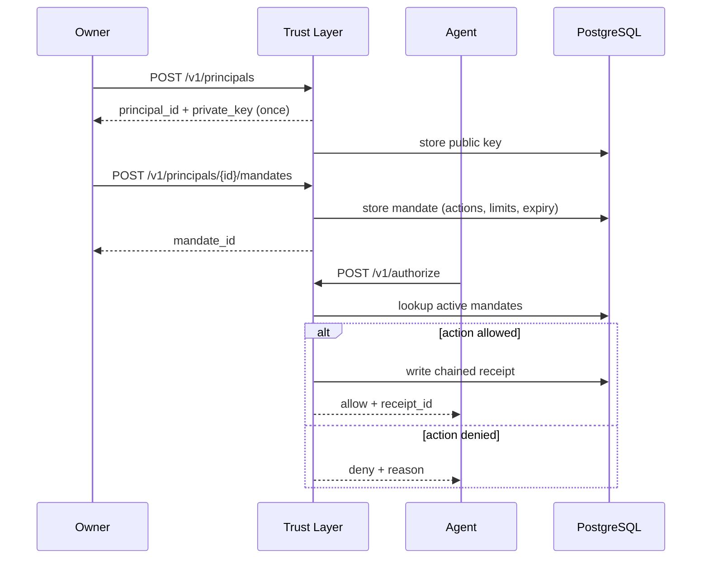

# Trust Layer

**A trust infrastructure for autonomous AI agents.**

Trust Layer provides the three primitives every organization needs before it can safely deploy autonomous agents that make consequential decisions:

1. **Identity (KYA)** — Every agent has a verifiable cryptographic passport that binds it to its owner and defines what it is allowed to do.
2. **Authorization (Mandates)** — Every action is checked, in real time, against a signed mandate with explicit constraints (amounts, rate limits, expiry).
3. **Audit (SCITT-style receipts)** — Every allowed action produces a tamper-evident receipt, chained by hash, that an external auditor can verify independently.

The result: an agent can act autonomously, and you can **prove** exactly what it did, when, and under what authority.

---

## Why this matters

Autonomous AI agents are moving from demos to production. They approve loans, initiate payments, flag fraud, and answer customers. But every organization deploying them faces the same three questions:

- **Who is this agent, and who is responsible for it?**
- **What is it allowed to do, and within what limits?**
- **Can I prove, months later, that it acted within those limits?**

Regulators are starting to require answers. The EU AI Act (Article 12) mandates automatic logging for high-risk AI systems. Sector regulators (ACPR, FDA, SEC) demand auditable decision trails. Insurers will not cover autonomous agents whose actions cannot be reconstructed.

Trust Layer is a **minimal, open reference implementation** of the primitives that answer these three questions.

---

## Architecture



The key insight: **the agent never talks to the owner**. It only talks to Trust Layer, which independently verifies the mandate. The audit receipt is created by Trust Layer, not by the agent — the agent cannot forge or suppress it.


## Endpoints

| Method | Path | Purpose |
|---|---|---|
| `GET` | `/health` | Health check |
| `POST` | `/v1/principals` | Register an agent, receive its Ed25519 private key **once** |
| `GET` | `/v1/principals/{id}` | Retrieve an agent's public view (never the private key) |
| `POST` | `/v1/principals/{id}/mandates` | Define what the agent is allowed to do and for how long |
| `GET` | `/v1/principals/{id}/mandates` | List all mandates attached to an agent |
| `POST` | `/v1/authorize` | Check an action against active mandates; if allowed, create a chained receipt |

Full interactive documentation: **http://localhost:8000/docs** (Swagger UI, auto-generated).

---

## Quick start

### Prerequisites

- Python 3.11+
- Docker (for PostgreSQL)

### 1. Start PostgreSQL

```bash
docker run --name trustlayer-db \
  -e POSTGRES_PASSWORD=devpassword \
  -e POSTGRES_DB=trustlayer \
  -p 5432:5432 \
  -d postgres:16


### 2. Set up the backend

```
bash
cd backend
python3 -m venv .venv
source .venv/bin/activate
pip install -r requirements.txt


### 3. Configure environment
```
bash
cp .env.example .env

### 4. Apply the schema
``` 
bash
docker exec -i trustlayer-db psql -U postgres -d trustlayer < schema.sql

### 5. Run
```
bash
uvicorn app.main:app --reload --port 8000
Open http://localhost:8000/docs.

End-to-end example

###1. Register an agent
```
bash
curl -X POST http://localhost:8000/v1/principals \
  -H 'Content-Type: application/json' \
  -d '{
    "principal_name": "loan-approval-bot",
    "owner_id": "bank:demo:risk-dept",
    "principal_type": "agent",
    "profile": "banking"
  }'

 ### 1. Response (201):
 
```
json
{
  "principal_id": "5d1cc5e9-aaa1-4796-826e-5561f60ab84f",
  "principal_name": "loan-approval-bot",
  "public_key_jwk": { "kty": "OKP", "crv": "Ed25519", "x": "..." },
  "private_key_b64": "jPdRF-Y7ocTSCw93m6LSne9g-G-EzITyozpca1uzk6U",
  "status": "active",
  "created_at": "2026-11-05T18:39:49.403138Z"
}

### 2.Attach a mandate

```
bash
curl -X POST http://localhost:8000/v1/principals/{principal_id}/mandates \
  -H 'Content-Type: application/json' \
  -d '{
    "allowed_actions": ["payment.initiate"],
    "constraints": { "max_amount_eur": 100 },
    "valid_for_hours": 24
  }'

### 3. Request authorization
   
bash
curl -X POST http://localhost:8000/v1/authorize \
  -H 'Content-Type: application/json' \
  -d '{
    "principal_id": "{principal_id}",
    "action": "payment.initiate",
    "constraints": { "amount_eur": 42 }
  }'  


### Allowed:

```
json
{
  "decision": "allow",
  "reason": "action authorized by mandate",
  "mandate_id": "faaf737e-9d03-46f5-ba21-599893e3d50d",
  "receipt_id": "5c8f816b-3910-45c0-a69e-f5f261c08d61",
  "timestamp": "2026-11-05T18:39:49.627653Z"

}


### Denied (amount over limit):

json
{
  "decision": "deny",
  "reason": "amount_eur=500 exceeds limit 100",
  "mandate_id": "faaf737e-9d03-46f5-ba21-599893e3d50d",
  "receipt_id": null
}
### Denied (action not in mandate):

json
{
  "decision": "deny",
  "reason": "no active mandate allows action 'invoice.approve'",
  "mandate_id": null,
  "receipt_id": null
}

## What this proves

- An agent **cannot act outside its mandate** — the authorization endpoint rejects it with a precise reason.
- Every allowed action produces a **tamper-evident receipt** stored in an append-only, hash-chained audit log.
- Every receipt is **independently verifiable**: given the receipt and the agent's public key, any third party can confirm what happened.
- A `deny` decision leaves **no receipt** — the audit trail records successful actions, not attempts.

## What this does NOT do (yet)

Honest limitations of the current reference implementation:

- **Single-issuer receipts.** In real SCITT, a separate transparency service signs a receipt over the issuer's statement, and witnesses replicate it. Here, one service signs everything. See [`NOTES.md`](./NOTES.md) for the full gap analysis.
- **No real x402 integration.** Payments are simulated (no HTTP 402 challenge, no facilitator, no on-chain settlement).
- **No KYC/KYB binding.** `owner_id` is free-form. A real KYA profile would bind it to a verified legal entity.
- **No revocation endpoint.** A compromised agent remains valid until its mandates expire. A `POST /v1/principals/{id}/revoke` is on the roadmap.
- **Chain head not replicated.** The current store is PostgreSQL, but the hash-chain head is held in application memory between requests. In production, the chain head must be replicated and published to witnesses.

These gaps are **intentional**. The goal of this repository is to prove the mechanism, not to ship a production system.

## Status

- [x] **Phase 0** — Working PoC (identity, mandates, authorization, receipts)
- [x] **Phase 1** — Reference implementation (FastAPI + PostgreSQL)
- [ ] **Phase 2** — Production hardening (revocation, real SCITT receipts, HSM/KMS integration)
- [ ] **Phase 3** — Ecosystem (profiles, witnesses, standardized endpoints)

## Tech stack

| Layer | Technology |
|---|---|
| API | **FastAPI** — async REST API with auto-generated OpenAPI / Swagger |
| ORM | **SQLAlchemy 2.0** — with JSONB support |
| Datastore | **PostgreSQL 16** |
| Crypto | **Ed25519** (`cryptography`) — signing and verification |
| Schemas | **Pydantic v2** — request/response validation |

## References

- **SCITT** (Supply Chain Integrity, Transparency and Trust) — [IETF Working Group](https://datatracker.ietf.org/wg/scitt/)
- **x402** — HTTP 402-based payments for agent-to-agent transactions — [x402.org](https://x402.org)
- **EU AI Act** — Articles 12 (record-keeping) and 50 (transparency) — [official text](https://eur-lex.europa.eu/eli/reg/2024/1689/oj)
- **KYA** (Know Your Agent) — emerging framework, see Visa / Mastercard / Ant International collaboration

Related documents in this repository:

- [NOTES.md](./NOTES.md) — known gaps and roadmap to production
- [LICENSE](./LICENSE) — MIT license
